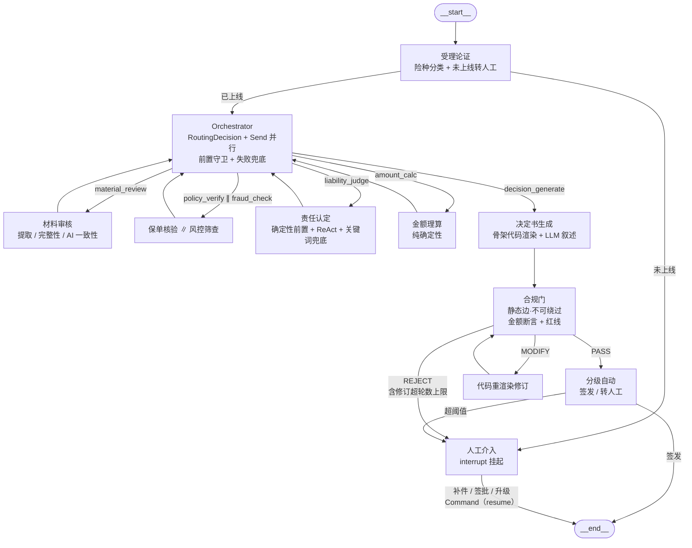

# claimflow — 保险理赔智能核赔平台（多险种）

[](https://github.com/Soleil1043/claimflow/actions/workflows/ci.yml)
[](https://www.python.org/)
[](LICENSE)
[](https://docs.astral.sh/ruff/)

客户提交理赔申请和材料后，LLM Orchestrator 会调度六个专业 Worker（材料审核、保单核验、
风控筛查、责任认定、金额理算、决定书生成）完成自动核赔：低风险小额案件直接签发
《理赔决定书》，其余转人工复核。各险种的领域知识放在 skill 规程包
（`skills/<stage>/<line>.md`）里，调准确率只改文本，不动代码。

> **项目状态（2026-11-09）**：维护期。任务清单 T001-T223 已全部交付，其中 T200-T222 是
> 一轮全仓库代码审查的修复批次（决定书结论、客服查案授权、评测门口径、部署安全等），
> T223 是随后的全项目文档核对。全量测试 735 passed（2026-11-08 复测）。

> **TL;DR** — A multi-line insurance auto-adjudication platform: an LLM Orchestrator
> dispatches six specialized workers over a case pipeline, with precondition guards in code,
> a graph-enforced compliance gate that routing can never bypass, and deterministic fallback
> on any LLM failure. HITL tickets (supplement / review / escape) via interrupt + resume,
> plus an in-portal AI support agent with human escalation. All external systems are
> faithfully mocked; runs end-to-end on a real LLM.

## 目录

1. [一次核赔长什么样](#1-一次核赔长什么样)
2. [成果指标](#2-成果指标)
3. [核心能力一览](#3-核心能力一览)
4. [架构](#4-架构)
5. [快速开始](#5-快速开始)
6. [可选组件](#6-可选组件)
7. [评测体系](#7-评测体系)
8. [API](#8-api)
9. [设计决策](#9-设计决策)
10. [已知限制与路线图](#10-已知限制与路线图)
11. [安全与数据声明](#11-安全与数据声明)
12. [深入阅读（文档地图）](#12-深入阅读文档地图)
13. [License 与作者](#13-license-与作者)

---

## 1. 一次核赔长什么样

> **客户**：提交一个案件：急性阑尾炎住院手术，花费 15,800 元，保单 POL-2025-0001，
> 上传发票、诊断证明、费用清单。
>
> **系统**：`intake`（保单产品类型分类 → 医疗险，已上线）→ `orchestrator`（LLM 调度，
> 守卫强制先做材料审核）→ `material_review`（三段提取 + 完整性 + AI 一致性）→
> `policy_verify ∥ fraud_check`（并行：保额 100 万 / 免赔 1 万、无黑名单记录）→
> `liability_judge`（确定性前置通过 → ReAct 条款检索，covered）→ `amount_calc`
> （确定性：(15800−10000)×0.8 = 4,640 元）→ `decision_generate` → `compliance_gate`
> （金额三方断言 + 红线检查，PASS）→ 自动签发《理赔决定书》，案件关闭。
>
> 全程审计事件落库，路由决策里守卫的修正也能回放。材料有缺失时，案件挂起为补件
> 工单，客户补传后自动恢复。

---

## 2. 成果指标

> 数字来自金样本评测门（`evals/adjudication_suite.py` 六门体系）加独立对抗回归门。
> 对抗类指标和负向指标放在前面是有意的：它们证明评测门本身在工作，不只是走形式。
> 下表是 CI 确定性档（零 LLM）的结果；两个 LLM 档（调度档、全程调用模型档）见下方分项。

| 门 | 数值 | 说明 |
|------|------|------|
| 金额正确率（硬门） | 100% | 153 案期望金额按规格公式精确到分，逐一断言 |
| 红线漏放（硬门） | 0 | 与运行时合规门同一实现（check_text）复验 |
| 守卫旁路（硬门） | 0 | 必做集未全 done 而出决定书的案件数 |
| 路由一致率（软门） | 100%（门禁 ≥95%） | 与金样本期望派发序列一致 |
| 责任认定一致率（软门） | 100%（门禁 ≥90%） | 确定性前置 + ReAct + 关键词兜底三层口径 |
| 调度预算 | 5 ≤ 15/案件 | orchestrator 防绕圈预算（D039） |
| 对抗集 injection（硬门） | 8/8 | 注入、诱导、PII 共 8 条，确定性和 LLM 双模式全绿。LLM 档曾被诱导 3/8（T130 实测），T131 把路由 prompt 改成数据定界（`<<<DATA…>>>DATA` 加铁律）后 0 被诱导（[T130→T131 报告](evals/reports/t131_adversarial_llm.json)）。T159 起从原 14 案中拆出，最容易对 fixture 过拟合的关键词路径移入 hold-out 盲测 |
| 对抗集 hold-out（硬门） | 30/30 | robustness 6 seed + 24 条红队变体（8 seed × 12 变异器，framework_ref 溯源 Garak/PyRIT，含材料内藏指令家族 T173），不进 push CI，走 nightly 盲测（T159） |

- LLM 调度档全量 153/153，六门全绿（deepseek-flash 真实调度、worker 确定性执行；
  2026-09-21，[报告](evals/reports/t130_llm_full_v41_fixed.json)，T130）
- 全程调用模型档（`--llm --llm-workers`，调度、材料 AI 审查、责任 ReAct、决定书叙述
  全走 LLM，与生产同构）一致率 88.9%（136/153）：三个硬门全绿，路由软门 88.9% 没到
  95%（2026-10-07 快照，[T160 报告](evals/reports/t160_ablation_report.md)）。17 例
  失配全是低置信度转人工，方向是保守不是放水
- 调度成本实测 7,659 tokens/案、4.4 次 LLM 调用；确定性档 0.25s
- 成本按 ¥ 算（T177，D083）：`LLM_PRICING` 单价表（¥/百万 token，配置驱动）落到
  `claimflow_llm_cost_cny_total{model,stage}` 指标、Grafana 单案成本面板和评测报告的
  `cost_cny_per_case_avg` 字段。30 案 LLM 评测按单价表估算约 ¥0.006/案（整体缓存
  命中率 82.4%、路由调用 86.8%；无缓存约 ¥0.016/案）。单价表是文档口径估算，看
  趋势和量级用，不用于结算
- 单元与集成测试 735 passed（2026-11-08 复测，覆盖图结构断言、守卫注入、interrupt
  跨重启恢复、死信重驱与审计回放、图检索与精排）；CI 覆盖率门 ≥85%（T149，基线 88% 留 3pp 缓冲）
- 负载测试（T150）：50 / 100 并发提交全稳定，提交 3.2-3.5 案/s，确定性档排空约
  140 案/min，E2E P95 35-70s。压测压出两个真实缺陷并已修复：案号生成的读-判-写
  竞态（并发撞号）和连接池耗尽。另外留了升 SKIP LOCKED 的判据：日案件量过万或
  排空超 10 分钟
- 单 Agent 消融（T160，153 案双侧全 LLM 真跑，[报告](evals/reports/t160_ablation_report.md)）：
  多 Agent 88.9%（136/153，硬门全绿）对单 Agent 60.8%（93/153，金额硬门失守 88.9%）。
  差距主要在错误自动签发 0 对 27 案：单 Agent 没有前置守卫、材料置信度门、自动签发
  置信度门这三道确定性防线。token 反而多 70%；单案时长 11.87s 对 7.57s（单 Agent
  调用次数少所以略快，多 Agent 的 worker 能并行）
- RAG 评测（T161，责任认定阶段，24 题评测集，[报告](evals/reports/t161_rag_eval.md)）：
  向量检索路径 Recall@1=54% / @2=79% / @4=95.8%（23/24）/ @8=100%，MRR 0.724；RAGAS 四指标
  CP=0.868 / CR=0.806 / FA=0.929 / AR=0.909。重排与图谱检索不在此口径内
- 叙述 judge×人工对账（T178）：在 5% 叙述抽评之上加观测性 LLM judge（rubric 三维
  0-2 分，≥4 过），人工 verdict 作金标准算一致率，judge-only 输出低于阈值清单。
  观测层不进门禁。judge 会不会偏？答案是用人工度量 judge 本身

---

## 3. 核心能力一览

| 能力 | 一句话价值 |
|------|-----------|
| LLM Orchestrator-Worker | RoutingDecision 结构化输出 + Send 并行派发，前置条件由代码守卫强制 |
| 静态合规门 | decision_generate → compliance_gate 是图上焊死的边，任何路由决策无法绕过 |
| 分级自动签发 | 低风险 + 责任明确 + 链路置信度达标才自动出《理赔决定书》，给付案另需金额在签发线内；拒赔同样要过风险与置信度两关（不看金额线），否则转人工（阈值全配置化） |
| HITL 三类工单 | 补件 / 核赔复核 / 升级。interrupt 挂起，客户补传自动恢复，坐席结论必过合规复审 |
| 险种 pack | `schemas/lines.py` 一份 pack = 一个险种的全部知识；医疗/车险/财产险/意外险四线已上线（T120），产品类型不在任何 pack（unknown）受理转人工 |
| 知识图谱混合召回（T031/T032） | 12 篇条款文档抽取实体关系三元组（险种/疾病 ICD-10/规则条款），内存邻接表多跳遍历补充结构化事实（`services/rag/knowledge_graph.py`，图谱落盘 `data/graph/` 幂等重建） |
| StageSpec 单源 | 六阶段的名字 / 前置 / 快照 / 回边 / prompt 清单由一份注册表派生（加阶段只改一处） |
| 金额安全设计 | 全链路 Decimal，正文金额三方断言不依赖 LLM，叙述段零金额注入 |
| 在线客服（T132-T137） | 门户悬浮 AI 助手（RAG 问答 / 案件进度查询 / 报案链接预填）+ 转人工坐席闭环（escalated 状态机 + workbench 客服工单） |
| 申请人记忆治理（T138） | 终态确定性渲染写入，置信度门控（< 0.6 不写）+ 应用层 TTL + 坐席删除链路 |
| 决定书叙述抽评（T139） | 5% 确定性采样人工质检（种子 = case_id 可复算），workbench 抽评队列 + 通过率统计 |
| 对抗回归门（T124/T142/T159） | injection 8 案守 push CI，robustness 6 seed / 24 变体入 hold-out 盲测集（关键词路径最易过拟合，恰需盲测）。变体分类法对齐 Garak promptinject / PyRIT converters-attacks，带 framework_ref 溯源 |
| Prompt 缓存观测（T162/T164/T165） | DeepSeek 硬盘缓存默认开启但此前是黑盒。做了三来源非标字段提取（`response_metadata.token_usage`，langchain 标准字段回退）和 stage 维度分列（区分布局缺陷与天然 miss）；布局改造后路由调用命中率三轮实测 86.7%–86.8%（整体 82.4%，详见[缓存事件报告](evals/reports/prompt_cache_miss_incident_report.md)） |
| 全链路可观测 | Prometheus/Grafana 22 面板（结案率 / 阶段 P95 / 调度健康 / 守卫纠错 / 缓存命中率按调用点 / 单案 token 与 ¥ 成本）+ OTel/Jaeger（span 含单调用 `cache_read/miss_tokens` 原值，采样率 0.2） |
| 审计回放与死信处置（T181/T182） | 只读 CLI 联合事件、交付回执与决定书版本断言五项不变量；死信 Gauge + Grafana 告警 + 坐席鉴权重驱端点，发现与处置闭环 |

---

## 4. 架构

系统自上而下分六层，依赖单向：前端（chatui 门户、workbench 工作台）、API 层（`app/`，
只做 HTTP 边界和鉴权限流）、图编排层（`nodes/` 加 LangGraph 状态机）、服务层
（`services/` 领域服务、RAG、记忆、可观测）、工具层（`tools/` ClaimflowTool）、数据层
（PostgreSQL / Qdrant / Redis / Checkpoint）。节点只做编排和状态流转，业务规则都在服务层
和工具层。分层全图见 [docs/architecture.md](docs/architecture.md) §2。案件沿下图流转：



四个要点：

1. **阶段知识单源（StageSpec）**：六阶段的结论 channel、产出模型、前置条件、路由快照
   字段、prompt 清单由 `schemas/stages.py` 注册表派生。守卫查表、图回边、评测断言和
   LLM 看到的目标清单全部同源
2. **安全对冲四件套（D039）**：静态合规门不可绕过、前置守卫违规改投、LLM 失败走险种
   确定性默认计划、路由决策全量审计落 case_events
3. **险种 pack（InsuranceLinePack）**：受理分类、必需材料、条款要素、责任认定兜底规则
   一份声明式数据。上新车险就是新增 pack 加 skill 文本，节点零改动
4. **状态持久化**：LangGraph Checkpoint（prod=AsyncPostgresSaver，thread_id=case_id）
   支撑 interrupt 挂起和跨服务重启恢复；案件事实态以 cases 表为准

---

## 5. 快速开始

### 5.1 本地开发（dev profile：SQLite + Qdrant local mode，零容器依赖）

```bash
# 1. 安装
git clone https://github.com/Soleil1043/claimflow.git && cd claimflow
uv sync && cp .env.example .env    # .env 填入 LLM_API_KEY（DeepSeek）

# 2. 初始化数据（建表 + Mock 种子 + 知识库向量化，均幂等）
uv run alembic upgrade head
uv run python -m scripts.seed
uv run python -m services.rag.ingest    # 首次运行下载 BGE-M3 模型（~2GB）

# 3. 启动
uv run uvicorn app.main:app --port 8000       # 后端 API
cd chatui && npm install && npm run dev       # 案件提交门户 http://localhost:3000
```

### 5.2 Docker 一键（prod profile：PostgreSQL + Qdrant + Redis）

先在 `.env` 里填好 `STAFF_KEYS`、`PII_ENCRYPTION_KEY`、`POSTGRES_PASSWORD`、`REDIS_PASSWORD`（compose 必填，生成方式见 `.env.example`；prod 会拒绝仓库里出现过的演示值）。只有 app 的 8000 端口对外发布，数据库、Redis、Qdrant 和观测界面都只绑本机 127.0.0.1。

```bash
docker compose up -d --build
curl http://localhost:8000/health   # → {"status":"ok"}
```

要多副本就加 override 文件（T155，D071）：

```bash
docker compose -f docker-compose.yml -f docker-compose.replicas.yml up -d --scale app=2
```

宿主端口区间映射自动分配 8000/8001，uploads 走共享卷，交付队列靠租约互斥，checkpoint
走共享库。CI 的双副本冒烟就是这个口径。

### 5.3 验证与测试

```bash
uv run pytest -q                                   # 735 passed（2026-11-08 复测）
uv run ruff check .
uv run python -m evals.adjudication_suite          # 金样本评测门（确定性，零 LLM）
uv run python -m evals.adjudication_suite --dataset adversarial          # 注入硬门（8 案）
uv run python -m evals.adjudication_suite --dataset adversarial_holdout # 红队 hold-out 盲测（30 案）
uv run python -m evals.adjudication_suite --llm --limit 30 --concurrency 3  # LLM 档分片
uv run python -m evals.single_agent_baseline       # 单 Agent 消融对照（T160）
uv run python -m scripts.eval_rag --help          # RAG Recall@K + RAGAS 四指标（T161）
uv run python -m scripts.redteam_adversarial --probe  # 红队变体实跑判定（T159）
uv run python -m scripts.verify_adjudication --offline   # 离线兜底档（零 API Key）
uv run python -m scripts.verify_multiinstance --boot --offline   # 双实例 live 冒烟（自起 8010/8011，跨实例补件恢复）
uv run python -m scripts.verify_adjudication             # 完整档（需真 Key：自动签发+金额+决定书）
uv run python -m scripts.smoke_support_e2e         # 客服全链路冒烟（需真 Key + dev 栈）
uv run python -m scripts.measure_cache_hit_rate     # Prompt 缓存真实命中率实测（需真 Key）
uv run python -m scripts.probe_deepseek_cache_usage # 缓存字段存活探针（全 mock，免 Key）
uv run python -m scripts.load_test --help          # 负载压测：吞吐 / P95 / 错误率（T150）
uv run python -m scripts.judge_narrative --limit 20 # 叙述 judge×人工对账（T178，需真 Key）
uv run python -m scripts.replay_audit --all --format table # 审计回放；历史 dev 库可能报真实异常
```

冒烟脚本走真实链路：现场生成 Word 材料，上传，走提取，看自动签发、补件闭环、未上线
险种 escape、工单列表。分两种档位：

| 档位 | 前置 | 覆盖 |
|------|------|------|
| `--offline`（默认兜底） | 零 API Key | 受理、上传落档、补件闭环、状态机、审计、escape、工单（材料提取降级 Mock → 置信度不足按设计转人工） |
| 完整档 | 真 Key | 上述 + 自动签发 4640.00 + 决定书（签发与金额正确性另有零 LLM 的评测门 coverage） |

CI 默认跑离线档，不需要任何 secret；仓库配了 `LLM_API_KEY` secret 时自动升级为完整档。
材料只声明不上传会按设计转人工（T140 置信度校准），所以必须上传真实文件才会走到
自动签发。

---

## 6. 可选组件

| 组件                           | 启动 | 入口 |
|--------------------------------|------|------|
| 监控栈（Prometheus + Grafana） | `docker compose --profile monitoring up -d` | Prometheus `:9090`（TSDB 保留 30d）、Grafana `:3001`（仅本机，匿名只读）。两个仪表盘共 22 面板：核赔 10（自动结案率 / 转人工率 / 调度调用 / 守卫纠错 / 阶段耗时 P95 / 端到端耗时 / 案件量 / 核定金额 / 单案 Token 均值 / 单案成本 ¥）+ 监控总览 12（工具成功率 / 案件转人工率 / P95 时延 / 工具与 LLM 调用量 / 熔断 / Prompt 缓存四面板 / 工具缓存命中率；v1 陈旧面板已于 T179 清理）。另有 4 条告警规则 provisioning 自动加载：自动结案率骤降 / 队列积压 / LLM 失败率过高 / 死信未处置（T154+T182） |
| 追踪栈（OTel + Jaeger）        | `docker compose --profile tracing up -d`<br>`.env` 设 `OTEL_ENABLED=true` | Jaeger UI `:16686`，span 含单调用 `gen_ai.usage.cache_read/miss_tokens` 原值（采样率 0.2） |
| 坐席工作台（HITL + 客服）      | `cd workbench && npm install && npm run dev` | `:5173` 核赔工单列表 + 详情（审计时间线 / 决定书版本卡 / 签批改判表单）+ 客服工单（transcript / 回复 / 关闭）+ 叙述抽评审队列。后端配了 `STAFF_KEYS` 时先在 `/login` 输入坐席 Key（存 HttpOnly Cookie，由 middleware 注入 `X-Staff-Key`，T215）；dev 未配置时免登录 |
| 案件提交门户                   | `cd chatui && npm install && npm run dev` | `:3000` 提交 + 进度时间线 + 决定书查看 + 补件上传 + 悬浮 AI 客服（问答 / 查进度 / 转人工） |

- 后端裸指标：`http://localhost:8000/metrics`（不需要监控栈）
- 端口提示：Grafana 映射在宿主 3001（T217 起），与 chatui dev 的 3000 不再冲突；匿名只读，需要改面板/告警请改 provisioning 文件或自行配正式认证

---

## 7. 评测体系

金样本评测集 153 案件（`evals/datasets/adjudication.json`，生成器确定性枚举 + 24 手工
底座），覆盖正常签发 / 拒赔 / 部分责任 / 风控 / 边界 / 缺件 / 受理分类七类，医疗、车险、
财产险、意外险四线，期望金额按规格公式精确到分。

对抗回归集拆分 + badcase 回流（T159/T174）：

| 数据集 | 规模 | 内容 | 门禁位置 |
|---|---|---|---|
| `adjudication_adversarial.json` | 8 案 | 注入 / 角色伪装 / 虚构免责 / 红线诱导 / PII 诱导 / 施压翻转 / 事实伪造 / 字段注入 | push CI 硬门 |
| `adjudication_adversarial_holdout.json` | 30 案 | robustness 6 seed + 24 条红队变体（8 seed × 12 变异器，含材料内藏指令） | nightly 盲测（周期跑，不进 push） |
| `adjudication_regression.json` | 按 triage 积累 | badcase 回流回归集（T174，D080）：坐席改判案经人工 triage 采纳后并入（REG-xxx，期望=坐席终局决议） | 手动 / 可挂 nightly（缺文件或空集自动跳过） |

为什么拆：同义词鲁棒性走关键词路径，最容易对 fixture 过拟合。留在 push CI 里，
"过了"就是个假信号；盲测集才反映真实泛化。变体分类法对齐 Garak promptinject /
PyRIT converters-attacks，`evals/redteam.py` 带 `framework_ref` 溯源字段。

数据飞轮（T174，D080）：坐席改判（决定书版本链 auto→agent 且结论或金额变化）经
`scripts/export_badcase_cases` 扫描为候选，人工 triage（`regression_candidates.json`
里改 status=adopt/drop，防止坐席误操作回流成脏标签）后 `--commit` 并入回归集，再用
`--dataset regression` 回归。回流案独立成集，不混进 153 金样本基线，口径不漂移。

```bash
uv run python -m evals.adjudication_suite                 # 主门 153 案（确定性，零 LLM）
uv run python -m evals.adjudication_suite --llm                 # LLM Orchestrator 全链（真实 LLM）
uv run python -m evals.adjudication_suite --dataset adversarial # 注入硬门 8 案
uv run python -m evals.adjudication_suite --dataset regression  # badcase 回归集（T174，缺文件跳过）
uv run python -m evals.adjudication_suite --dataset adversarial_holdout  # 盲测 30 案
uv run python -m evals.adjudication_suite --llm --concurrency 3 --limit 30  # LLM 档分片
uv run python -m evals.adjudication_suite --limit 20            # 子集冒烟（nightly-llm 主门 LLM 档即 20 案抽样口径；push CI 跑确定性全量）
uv run python -m evals.support_suite                            # 客服问答门 15 案（真实 LLM，T146）
```

消融与 RAG 评测（面试证据三件套）：

| 实验 | 命令 | 结论 |
|---|---|---|
| 单 Agent 基线（T160） | `uv run python -m evals.single_agent_baseline` | 多 Agent 88.9% vs 单 Agent 60.8%，金额硬门失守 88.9%；错误自动签发 0 vs 27 案、token +70%（[消融报告](evals/reports/t160_ablation_report.md)） |
| RAG 质量（T161） | `uv run python -m scripts.eval_rag` | Recall@4=95.8%（23/24）、MRR 0.724；RAGAS 四指标 0.806~0.929 |
| 红队变体（T159） | `uv run python -m scripts.redteam_adversarial --probe` | 8 条注入变体全部被结构化字段纪律 + 守卫 + 合规门守住 |

六门体系：硬门（金额正确率 100% / 红线漏放 0 / 守卫旁路 0 / 对抗集全过）+ 软门
（路由一致率 ≥95% / 责任一致率 ≥90%）+ 预算（调度调用 ≤15）。门禁阈值和运行时配置
同源（`schemas/contract.py`），评测门就是运行时门，不会漂移。

客服问答门（`evals/datasets/support_qa.json`，15 案五类：知识 / 进度 / 红线 / 库外 /
转人工）：关键词组 + 禁止词 + 转人工终态三层确定性判分，硬门 100%，检索命中率作分层
观测。客服 Agent 没有确定性路径，这个门需要真 Key，定位是本地手动门（CI 只跑数据集
校验和判分单测）。

---

## 8. API

### 核赔案件

| 接口 | 方法 | 说明 |
|------|------|------|
| `/api/v1/cases` | POST | 提交案件（自然键幂等；后台队列驱动核赔管线，受理即返回） |
| `/api/v1/cases/{id}` | GET | 案件详情：进度 / 结论 / 决定书版本 / 审计时间线（坐席看完整 seq 回放；申请人只看白名单投影，内部错误、调度细节、落盘路径不外露，T212） |
| `/api/v1/cases/{id}/materials` | POST | 上传材料（图片/PDF/Word 两段式提取；补件挂起时自动恢复流程） |
| `/api/v1/cases/material-catalog` | GET | 险种材料目录（pack 单源派生，新险种上线前端零改动） |

> 🔒 **坐席端点鉴权**（T147，D067 路径 A）：标注 🔒 的端点需请求头 `X-Staff-Key`。
> 多 Key 配置（`STAFF_KEYS="alice:key1,bob:key2"`），Key 即身份：坐席名由 Key 派生，
> 审计 operator 不依赖请求体自报。dev 未配置时放行（向后兼容），prod 启动强制非空。
>
> 🔑 **案件门户访问令牌**（T171，D077）：`GET /cases/{id}` 与材料上传需请求头
> `X-Case-Token`（提交案件时创建回执一次性下发，库内只存 sha256 哈希；幂等重放不再
> 下发），或有效 `X-Staff-Key`（坐席双通道）；chatui 前端用 path 级 cookie 自动携带。
> dev 未配置 STAFF_KEYS 时沿坐席开放态放行（T147 兼容口径）。客服会话以客户端持有的
> uuid4 会话 id 为凭证；AI 客服查询案件进度还需会话级授权：用案件回执令牌调
> `case-grants` 端点，chatui 在案件详情页打开客服时自动完成（T202，D088）。未授权和
> 不存在的案件返回同一句话，防止枚举案件号。
>
> 🚦 **门户限流**（T172，D078）：`POST /cases`、材料上传（T213）与客服端点（建会话 /
> 案件授权 / 发消息）按客户端 IP 令牌桶限流（默认 30 / 30 / 60 每分钟，超限 429 +
> `Retry-After`）；prod Redis 共享桶、dev 进程内存；
> 配额 0 = 不限流（负载测试在服务器侧置 `RATE_LIMIT_CASES_PER_MIN=0` 后压测），拒绝
> 计数进 Prometheus（`claimflow_rate_limit_rejected_total`）。
>
> 🔒 **PII 分层治理**（T175/T176，D081/D082）：日志层零 PII（structlog 事件字段递归
> 脱敏，`LOG_MASK_PII` 默认开）+ 存储层加密（证件号列确定性 AES 落库，等值查询可用，
> ORM 全链路透明，`PII_ENCRYPTION_KEY` prod 强制）+ 出站渲染层脱敏（决定书/坐席改写，
> 既有）。明确不做"送 LLM 前脱敏"：保单核验本身就是证件号匹配，一刀切会破坏功能。

### HITL 工单

| 接口 | 方法 | 说明 |
|------|------|------|
| `/api/v1/interventions/cases` | GET | 核赔工单列表（补件 / 复核 / 升级挂起案件）🔒 |
| `/api/v1/interventions/cases/{id}/resolve` | POST | 工单处理：签批 / 改判（含改判拒赔）/ 补传 / 升级。坐席文本必过红线复审；草稿含红线话术时不能直接签批（422，须改写）；改判金额须 ≥0、最多两位小数 🔒 |
| `/api/v1/interventions/narrative-samples` | GET | 叙述抽评审队列（pending 样本 + 决定书全文 + 通过率统计）🔒 |
| `/api/v1/interventions/cases/{id}/narrative-review` | POST | 叙述抽评：pass / revise + 评语（落审计事件）🔒 |
| `/api/v1/interventions/jobs/dead` | GET | 死信队列清单（重试耗尽任务 + 死因，T182）🔒 |
| `/api/v1/interventions/jobs/{id}/redrive` | POST | 死信重驱：dead → queued（attempt 清零满额度，落 job_redrive 审计）🔒 |

### 在线客服（门户 ↔ 坐席）

| 接口 | 方法 | 说明 |
|------|------|------|
| `/api/v1/support/conversations` | POST | 建立客服会话（201） |
| `/api/v1/support/conversations/{id}` | GET | 会话状态（ai / escalated / closed，门户轮询入口） |
| `/api/v1/support/conversations/{id}/messages` | GET | 三方消息时间线（user / assistant / agent） |
| `/api/v1/support/conversations/{id}/messages` | POST | 发消息：ai 态 AI 应答；escalated 态坐席接管停答 |
| `/api/v1/support/conversations/{id}/messages/stream` | POST | 发消息（SSE 流式 AI 应答，T180）：token / done / error 三态事件 |
| `/api/v1/support/conversations/{id}/case-grants` | POST | 授权本会话查询某案件进度（`case_id` + 案件回执 `case_token`，T202） |
| `/api/v1/support/tickets` | GET | 坐席客服工单队列（escalated 会话倒序 + 最新消息预览）🔒 |
| `/api/v1/support/tickets/{id}` | GET | transcript 三方消息全文（closed 会话可查作审计）🔒 |
| `/api/v1/support/tickets/{id}/reply` | POST | 坐席回复（role=agent 入时间线）🔒 |
| `/api/v1/support/tickets/{id}/close` | POST | 关闭会话（备注先入时间线再流转终态）🔒 |

### 记忆治理

| 接口 | 方法 | 说明 |
|------|------|------|
| `/api/v1/memory/{user_id}/entries/{case_id}` | DELETE | 删除单条申请人记忆（adelete + human 审计事件）🔒 |

### 基础设施

| 接口 | 方法 | 说明 |
|------|------|------|
| `/health` | GET | 健康检查（postgres/qdrant/redis/llm 依赖状态） |
| `/metrics` | GET | Prometheus 指标 |

提交响应结构（新建 201 的后台交付受理快照；终态经 `GET /cases/{id}` 查询）：

```json
{
  "case_id": "CASE-2026-0001",
  "case_type": "medical",
  "status": "received",
  "final_decision": null,
  "approved_amount": null,
  "decision_document": null,
  "human": null,
  "idempotent": false,
  "job": {"status": "queued"},
  "decision_issued": false,
  "access_token": "<仅新建时一次性下发>"
}
```

`job` 还包含任务标识、类型和尝试次数等字段，上例只列了关键字段。幂等命中返回 200，
`access_token` 为 `null`。

---

## 9. 设计决策

全文最值得读的六条，完整决策链见 [`.agent/decisions.md`](.agent/decisions.md)：

1. **静态合规门是图结构保证而非约定**：decision_generate → compliance_gate 为静态边
   （有图结构测试断言），LLM 路由决策永远无法绕过
2. **LLM 调度的对冲四件套**：前置守卫违规改投 / 必做集强制收敛 / 失败走确定性默认
   计划 / 决策审计可回放（`scripts/replay_audit.py` 五不变量断言：seq 完整性、合规
   前置、路由预算、回执单源、死信一致）。orchestrator 失控不等于核赔失控
3. **金额不依赖 LLM**：理算是纯确定性工具，决定书正文做三方金额断言，叙述段零金额
   注入（骨架代码渲染），LLM 幻觉进不了金额字段
4. **skill 是调优面**：各阶段 SOP 装进 system prompt，准确率迭代改 `skills/` 文本不改
   代码；漂移由金样本路由一致率软门兜住
5. **阶段/险种知识单源**：StageSpec 注册表和 InsuranceLinePack 把"加一个阶段、上一个
   险种"从改 8-10 个文件变成加一份声明式数据
6. **坐席结论也过合规门**：HITL 恢复的人工结论经同一审查函数复审，违规不签发

---

## 10. 已知限制与路线图

| 限制 | 现状 | 下一步 |
|------|------|--------|
| dev 记忆/缓存仍进程内 | 交付队列与 checkpoint 已多实例安全（T155 租约 + sqlite 共享后端）；dev 的长期记忆 InMemoryStore 与工具内存缓存不跨实例共享 | 多实例 dev 对记忆为旁路降级；prod 用 PostgresStore/Redis 共享 |
| 客服 escalated 交互为轮询 | AI 应答已 SSE 流式（T180：token 逐段下发，done 后整体刷新校准）；坐席回复与案件进度保留轮询 | D085 有意取舍（不定时/分钟级事件维持长连接成本高于收益），实时性有诉求再评估 |
| 小语料 RAG 天花板 | 12 篇条款文档，检索增益有天花板 | 语料扩充后重开精排对比 |
| 客服日期推断 | 用户只说"9月20日"时模型自行补年份（应为当前年） | prompt 补"日期以当前年份推算" |
| 历史 dev 审计数据异常 | T181 对旧库 316 案回放发现 10 案共 11 条真实异常；现行写入防线已补齐，历史记录按追加原则保留 | 用 `scripts.replay_audit` 持续检查并逐案分诊 |

> 历史限制已清零：金额硬门 97.73%→100%（T122 等待期边界 + 日期 + frequency 信号三修）、
> 单险种→四险种上线（T120）、对抗集 57.1%→100%（T142 同义词清账）、CI 冒烟依赖
> secret→离线兜底档（T145）。演进记录见 [`.agent/progress.md`](.agent/progress.md)。

---

## 11. 安全与数据声明

- 全部业务数据是虚构 Mock：保单、病历、证件号都由种子脚本生成，不含真实 PII，
  数据结构参考了真实理赔场景
- 输出侧脱敏：身份证、银行卡、手机号在渲染层正则脱敏（`3301**********1234`），
  决定书正文签发前再过一遍红线检查（check_text）
- 密钥全走环境变量，仓库里没有真实凭据

---

## 12. 深入阅读（文档地图）

README 只放结论和入口，完整的论证过程都在下面这些文档里。

| 文档 | 内容 |
|------|------|
| [docs/architecture.md](docs/architecture.md) | 现状总览 17 节：分层架构 / 核赔主图 / Orchestrator / Worker 与 skill / 险种 pack / 合规与金额安全 / HITL / 客服域 / 记忆 / 交付队列 / 数据模型 / 可观测性 / 评测体系 / 部署 / 决策索引 / 已知限制 |
| [docs/claimflow-新架构设计.md](docs/claimflow-新架构设计.md)（[人话版导读](docs/claimflow-新架构设计-人话版.md)） | 核赔重写（T077-T093）的工程版设计依据与通俗导读 |
| [docs/diagrams/](docs/diagrams/) | 可交互工作流图（主图 / 案件流转，HTML + 明暗主题导出） |
| `docs/exercises/`、`docs/interview/` | 作者本地的动手练习与面试题库，未随仓库发布 |
| [evals/reports/](evals/reports/) | 评测报告族：消融（T160）/ RAG（T161）/ 红队证据（T159）/ 缓存事件报告 / 对抗门 / judge 对账（T178）。正文引用的报告都在这里 |
| [.agent/](.agent/) | 全程构建档案：[progress.md](.agent/progress.md) 构建日志、[decisions.md](.agent/decisions.md) 决策链 D001-D094、[tasks.md](.agent/tasks.md) 任务清单 T001-T223、[spec.md](.agent/spec.md) 需求规格、[plan.md](.agent/plan.md) 设计说明书 |

---

## 13. License 与作者

[MIT](LICENSE) © 2026 Soleil1043（[GitHub](https://github.com/Soleil1043)）

个人作品集项目，重点是 LLM 编排、合规工程和评测体系从零到一的完整实践；构建日志和
技术决策全部公开在 [.agent/](.agent/) 里。
